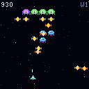

# Star Swarm

A plugin for the Pimoroni Art Matrix: a space shoot-em-up that plays itself.

A swarm of aliens flies in and settles into ranks, then they peel off and dive at the
ship, shooting as they come. Each wave dives more often and faster. The ship is flown by
a pilot of the skill you choose on the settings page:

| Pilot | Usually gets to |
| --- | --- |
| Beginner | wave 2 |
| Average | wave 4 |
| Skilled | wave 8 |
| Expert | wave 12 |

The better pilots move faster, look more often, see trouble sooner, allow for a target's
movement when they aim, and know that a diving alien follows them. The settings also have
the game's speed and whether the score, wave and ships left are shown.

Copy the `star_swarm` folder to `/lib/plugins/` on the board.
